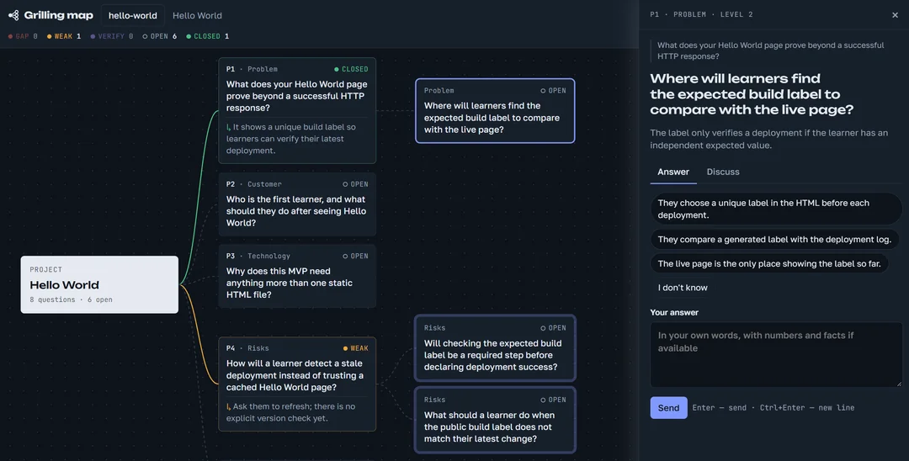

# VisualGrilling

A Codex and Claude Code skill for visual project grilling in your browser. The agent studies your project in the current session, opens a local map, and asks questions on it. You answer on the map; the agent grades your answers and digs deeper into weak spots. No additional API key is required.



## How grilling works

1. The agent studies the code and project description and creates a map with five main questions.
2. You choose an answer option or write your own. The agent assigns a status — Closed, Weak, Gap, or Verify — explains its verdict, and adds follow-up questions.
3. Use the discussion tab to clarify a question or challenge a verdict. Discussion alone does not change an answer's grade.
4. The add-questions button expands the review with three main questions. The finish button requests a verdict, key risks, and checks for the coming week.

At any stage, **Create spec** generates an implementation plan at `docs/specs/grill-<name>.md` inside the project being reviewed. **Update spec** rebuilds the entire file, including any manual edits. Unnamed maps use `grill-legacy.md`. The simulator produces only a demonstration document marked `[sim]`.

The map and event queue are saved in `.grill/<name>/`; the final report is saved as `report.md` in that directory. Unnamed maps store their files directly in `.grill/`. If the agent session closes, new actions wait in the queue and you can resume in a new session. Only one agent session should serve a given map.

The page and agent replies use the language in which you ask to start grilling. You can also explicitly request a language. The choice is saved per map. CLI diagnostics and simulator fixtures remain Russian.

## Installation

Requires Node.js 18+ and an installed Claude Code or Codex. No dependency installation or build step is needed.

From this repository's root, run the command for your agent:

| Agent | Command | Skill location |
|---|---|---|
| Claude Code | `npm run link:global` | `~/.claude/skills/grill` |
| Codex | `npm run link:codex:global` | `~/.agents/skills/grill` |

The installer links to `skills/grill`, so keep this repository in place. It preserves occupied directories and unrelated links and reports an error. To install for just one project, copy the entire `skills/grill` directory to `<project>/.claude/skills/grill` for Claude Code or `<project>/.agents/skills/grill` for Codex.

After installation, restart Claude Code or Codex and open the project you want to review.

## Start from chat

In **Claude Code**, write:

```text
grill my project
```

In **Codex**, write:

```text
$grill grill my project
```

The agent studies the project, starts the local server, and opens the map in your browser. You do not need to start the server or simulator manually. Answer on the map and keep the agent session open.

You can also review an idea without code: add a brief describing the product, its users, the problem it solves, and how it makes money. To resume the `main` map, write `continue grilling main` in Claude Code or `$grill continue grilling main` in Codex.

Codex skill locations and `$` invocation are described in the [official Codex documentation](https://learn.chatgpt.com/docs/build-skills).

Detailed developer documentation is in [docs/](docs/README.md).

## Developer debugging

Run the following commands from this repository's root unless a directory change is shown.

### Map and server without an agent

```bash
npm run sim          # start the server in test-project/.grill, load questions, open the browser
```

Answer on the map. The simulator uses simple heuristics: `не знаю` ("I don't know") or fewer than 4 characters → Gap; more than 25 characters with a digit → Closed; `думаю…` ("I think…") → Verify; otherwise → Weak. It adds follow-up questions, replies to discussions, and handles requests for more questions, a final summary, and a specification. The summary panel shows the current map state.

`npm run sim` reinitializes the selected map. Use `--keep` to continue a saved map.

- `npm run sim:keep` — continue the existing map without overwriting it.
- `node dev/simulate.mjs --delay 5000` — increase the simulated thinking time to inspect queue states in the UI.
- `node dev/simulate.mjs --name arch` — use a named map in `test-project/.grill/arch`; `npm run list` lists all maps.
- `npm run status` — inspect the unnamed map in `test-project`.
- `npm run stop` — stop all map servers in `test-project`, preserving their data.
- `npm run reset` — stop those servers and delete `test-project/.grill`, including all maps and reports.

Ctrl+C exits the simulator but leaves the map server running. Reload with F5 after editing `ui.html`. After editing `grill.mjs`, exit the simulator, run `npm run stop`, then `npm run sim:keep`. For a named map, pass the same name: `node dev/simulate.mjs --keep --name arch`.

Run `node dev/check-watch.mjs` to check background-wait transport and recovery, and `node dev/check-spec.mjs` to check specification creation and updates. It uses a temporary project and does not affect user maps. See the [development guide](docs/development.md) for other verification scenarios.

## Per-event workers

On hosts with verified background wake-up and foreground subagents, the main session dispatches each map event to a fresh worker. Other hosts retain the existing waiting loop. Shared event instructions live in `skills/grill/worker.md`.

The default worker model is `inherit` in `skills/grill/config.default.json`. Set `{"roles":{"griller":{"model":"sonnet"}}}` in the target project's `.grill/config.json` to override it (`inherit`, `opus`, `sonnet`, `haiku`). From that project, run `node "<skill directory>/grill.mjs" config` to inspect the merged settings; `--dir` selects a different config/maps root. No server is needed.

`watch --inbox` writes a full event to the map's `inbox.json` and prints a short line. The server generates `session.md` with brief, architecture, language and notes updated through `apply notes`. Run `node dev/check-workers.mjs` for transport checks, or `node dev/simulate.mjs --inbox --no-open --delay 200 --name sim-workers` for simulator coverage. Host/model integration requires the manual checks in the development guide.

## Parallel maps

Levels 1/2 can serve several maps in one session with one background watch per map and sequential event handling. Codex/level 0 keeps one map per session. The header switcher uses protected, read-only `GET /api/maps` to show sibling maps under the same `--dir`; it never starts/stops servers. Finished maps are unwatched after their queue drains, but their servers remain readable. `watch --inbox` event and expired lines carry `name` (null for legacy). Run `node dev/check-maps.mjs`; real host validation is described in [docs/development.md](docs/development.md).

A fresh checkout includes the npm scripts and helpers, simulator fixture `dev/fixtures/init.json`, and `test-project/.gitkeep`. Runtime `.grill/` directories are ignored. Explicitly continuing a finished map resets only the dispatcher's local completion/drain flags; it stays served until a new finish event, while the server keeps the previous summary.
